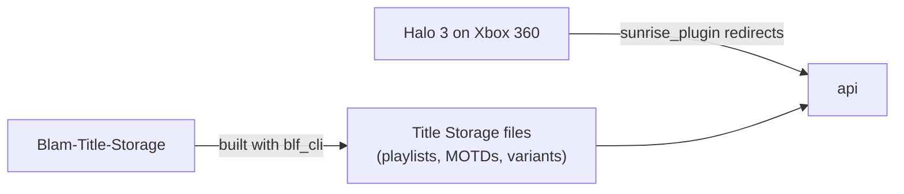

  

<h1 align="center">blam!network</h1>

  Online services and file formats for Bungie's games.
   
  <a href="https://blam.network"><b>blam.network</b></a>

 

blam!network brings Xbox 360 **Halo 3**, **Halo 3: ODST** and **Halo: Reach** back online. Matchmaking, File Share, service records, screenshots, MOTDs and more work again, and [blam.network](https://blam.network) shows your stats, carnage reports and files.

We also build open tools for Bungie's file formats.

blam!network was created by [Codie Newark (craftycodie)](https://github.com/craftycodie).

## Halo

<table>
<tr>
<td width="50%" valign="top">

### [blf](https://github.com/Blam-Network/blf)

Rust crates for BLF, the chunk-based file format of Halo 3, Halo 3: ODST and Halo: Reach. Includes `blf_lib`, the `blf_cli` tool that builds Title Storage, and `blf-ts` for TypeScript.

[Docs](https://blam-network.github.io/blf/) ·  

</td>
<td width="50%" valign="top">

### [sunrise_plugin](https://github.com/Blam-Network/sunrise_plugin)

A DashLaunch plugin that re-enables matchmaking in Xbox 360 Halo 3 by redirecting the game to custom servers. It checks the game build before it patches anything, and you can change its options in an INI file.

 

</td>
</tr>
<tr>
<td width="50%" valign="top">

### [Blam-Title-Storage](https://github.com/Blam-Network/Blam-Title-Storage)

The configuration for Title Storage, the online files that Xbox 360 Halo games download: matchmaking playlists, MOTDs, and map and game variants. Covers Halo 3 from early Delta builds to Release, Halo 3: ODST, and Halo: Reach.

 

</td>
<td width="50%" valign="top">

### [api](https://github.com/Blam-Network/api)

A NestJS reimplementation of the web services for Halo 3, Halo 3: ODST and Halo: Reach: matchmaking, File Share, Bungie Favourites, Bungie Pro, service records, screenshots, nameplates, crash reporting and more.

 

</td>
</tr>
</table>

 

blam!network is a fan project. It is not affiliated with Bungie, Microsoft or Xbox.

